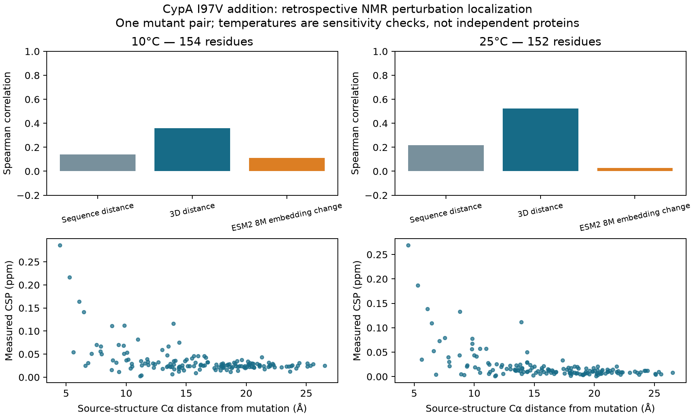

# Cyclophilin A pilot: measured baseline results

## What was actually tested

Can sequence distance, source-structure distance, or a small frozen sequence representation rank the residues whose measured backbone NMR chemical shifts change when I97V is added to S99T/C115S? This is a retrospective localization test on one mutant pair. It does not test whether a model predicts motion, activity, coordinated side-chain transitions, or equilibrium probabilities.

## Results

Site 97 and the two residues on each side are excluded in the primary analysis. NMR assignments and experimental conditions are matched before calculating shifts. Larger scores predict larger measured perturbations.

| Temperature | Method | Residues | Spearman | Top-quarter precision |
|---|---|---:|---:|---:|
| 10°C | Sequence distance | 154 | 0.141 | 0.385 |
| 10°C | 3D distance | 154 | 0.359 | 0.564 |
| 10°C | ESM2 8M embedding change | 154 | 0.110 | 0.282 |
| 25°C | Sequence distance | 152 | 0.217 | 0.342 |
| 25°C | 3D distance | 152 | 0.523 | 0.658 |
| 25°C | ESM2 8M embedding change | 152 | 0.027 | 0.237 |

Chance top-quarter precision is 0.253 at 10°C and 0.250 at 25°C. Residues are correlated and these are two temperatures of the same mutant pair, so neither is an independent validation cohort. All-site, ±5-residue exclusion, H-only and N-only sensitivities are in `summary.json`, with every residue in `residue_scores.csv`.

## Data integrity and limits

- 158 sites have paired H/N measurements plus source CA coordinates at 283 K; 156 at 298 K. After the primary local exclusion, 154 and 152 remain. Missing residues are listed explicitly; no imputation.
- Deposits 27217 and 27218 differ only by I97V, both at pH 6.5, and both document TROSY offsets. Their detail strings differ only in whitespace; initial literal metadata equality stopped the run, and whitespace normalization resolved it before scoring. No numerical shift values were changed.
- This does not prove the absence of a between-sample referencing offset. Error values include zeros; they are not a validated measurement noise floor. Small CSPs should not be interpreted as significant biological changes.
- Source structure 6BTA and target 5WC7 were measured at 273 K; WT 3K0N and S99T 3K0O at 288 K. Do not combine crystal occupancies with solution NMR as matched-temperature probabilities.
- The distance predictor uses 6BTA only. Target-mutant coordinates are reserved for identity/data auditing, not predictive scores. The pretrained model may have seen these sequences/structures during training; this is not a held-out generalization claim.
- NMR chemical shifts report local magnetic environments. Their changes are not direct measurements of flexibility, exchange rates, or catalytic effects. The published NMR exchange states also must not be equated automatically with individual crystallographic rotamers.
- BMRB assignments are machine-readable. Relaxation profiles are publicly plotted with fitted parameters, but raw instrument data were not located. No relaxation model was refitted.
- The ESM2 score, if present, is a frozen last-layer embedding difference. It has no learned calibration to ppm and generates no atomic ensemble. BioEmu2 was not run: the released software requires Linux and NVIDIA hardware, which this Mac lacks.

## What this enables next

Treat 3D proximity as a baseline to beat before claiming useful nonlocal mutation predictions. A separate all-atom study would have to recover compatible joint packing arrangements and test evidence beyond backbone RMSD. Four variants and these NMR tables cannot establish a new general benchmark, causal allostery, or publishable biological discovery.

## Provenance and related work

- Otten et al. (2018), experimental rescue series: https://doi.org/10.1038/s41467-018-03562-9
- BMRB 27217 and 27218; PDB 3K0N, 3K0O, 6BTA and 5WC7. Exact downloaded bytes and SHA-256 hashes are in `summary.json`.
- Wapeesittipan et al. (2019), simulations and alternative timescale interpretation: https://doi.org/10.1038/s42004-019-0136-1
- Cagiada et al. (2024), conformational free-energy prediction including CypA: https://doi.org/10.1002/pro.5233

The mutation-rescue mechanism is prior work. We have not established algorithmic or biological novelty. No exact public BioEmu2 test of this rescue series was located; absence of a named match does not exclude internal evaluation or training exposure.
